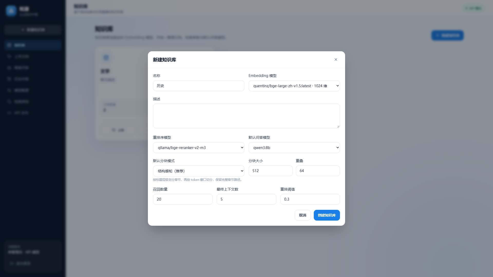
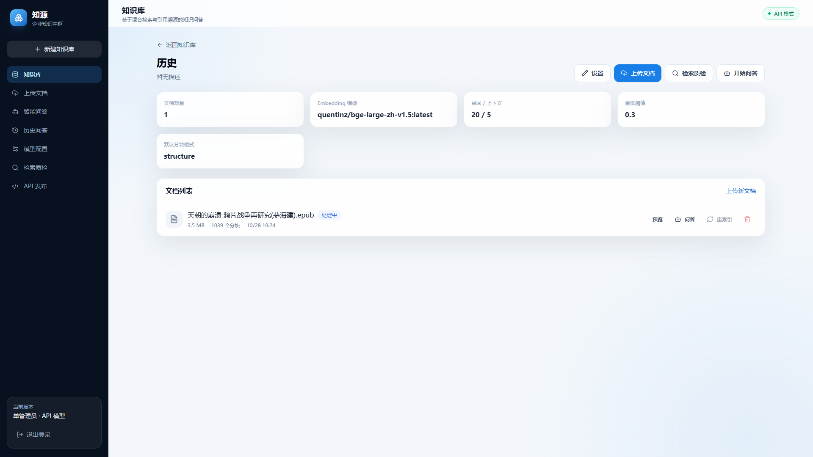
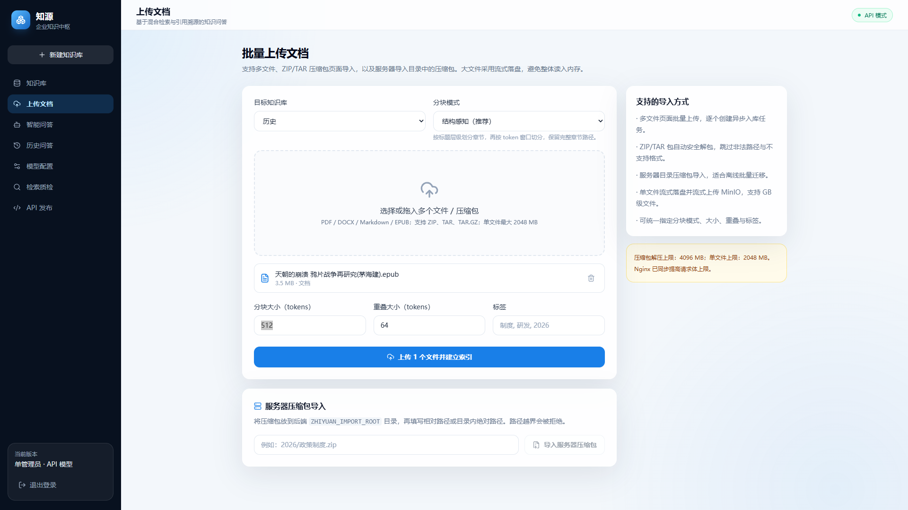
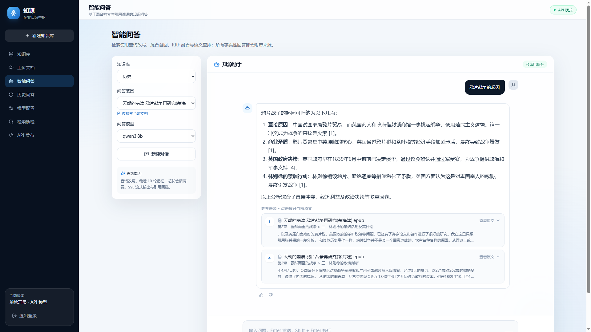
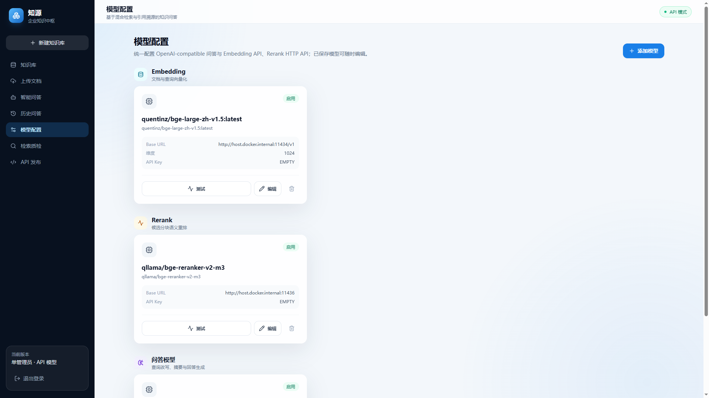
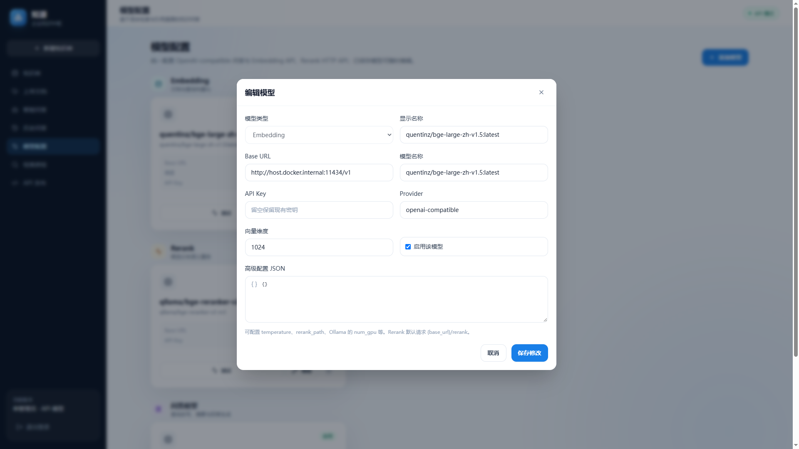
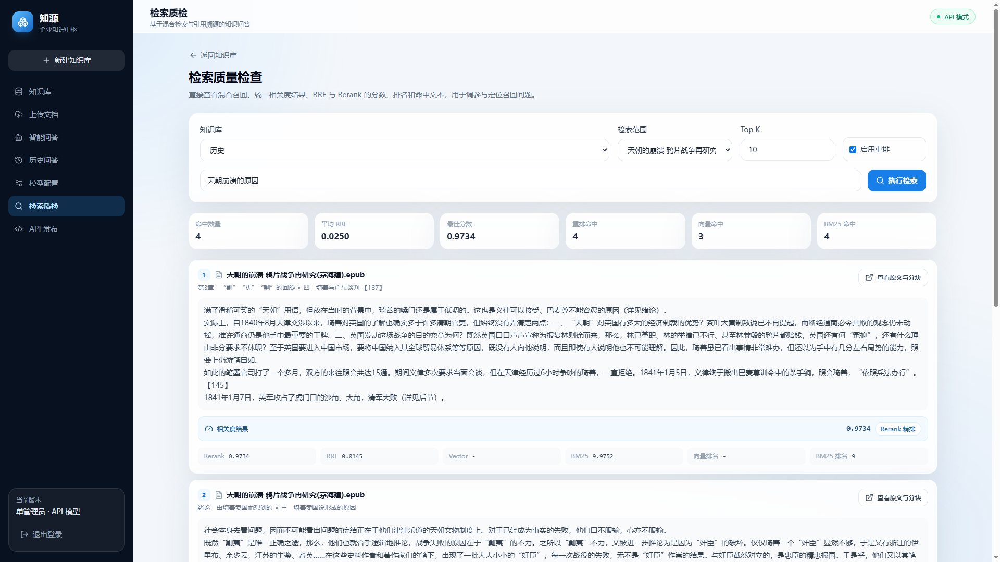
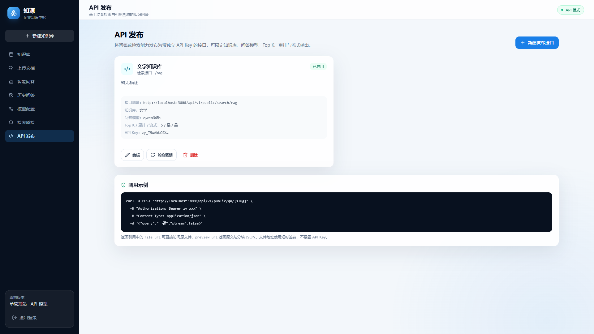
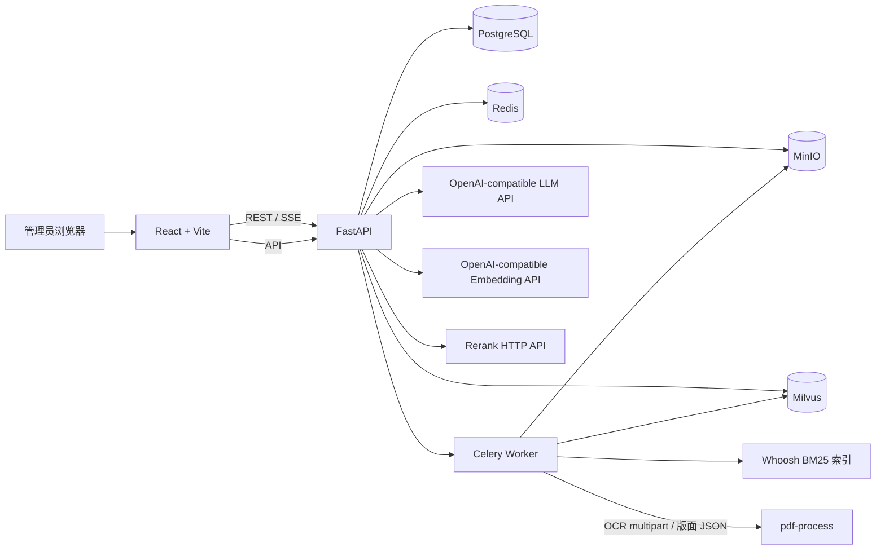

# 智库 · 企业知识中枢问答系统

基于 FastAPI、React、Milvus、PostgreSQL、Redis 与 MinIO 的单管理员 RAG 知识问答平台。支持 PDF、DOCX、Markdown、EPUB 文档入库，使用向量检索 + BM25 混合召回、RRF 融合、Rerank 精排、查询改写、会话摘要和 SSE 流式回答。

## 模块
### 知识库


### 文档上传

### 智能问答

### 模型配置


### 检索质量

### API发布


## 已实现能力

- 单管理员账号登录与 JWT 鉴权
- 模型配置管理：LLM、分块增强、Embedding、Rerank，支持连通性测试
- 知识库管理：固定 Embedding、分块增强与默认问答模型，配置召回、权重与重排参数
- 文档格式：PDF、DOCX、Markdown、EPUB
- 独立 `pdf-process` PDF 处理服务：RapidOCR/Tesseract OCR、LayoutParser/Detectron2 版面分析、内网 multipart/JSON API
- MinIO 原始文件存储，Celery + Redis 异步入库
- 章节优先、token 感知、带重叠的分块
- 分块关键词、约 50 字摘要与 3 个多样化 QA 对生成，失败自动规则回退
- Milvus 表示行多向量索引 + Whoosh 关键词增强 BM25 索引
- L1 章节摘要、L2 原块/摘要/问题、L3 原子块与 BM25 多路召回、加权 RRF、Rerank 精排
- 分块语义完整性评估：规则检测、LLM 语义评分、人工抽样复核与历史运行对比
- 知识库可移植导出/导入：文档包或含向量/BM25 快照的完整包，支持 ID 重映射和索引恢复
- 多跳问题识别与 IRCoT 式递归检索：规则/BERT/LLM 分层判定、最多 3 轮补检索、可见检索轨迹
- 多知识库联合检索：按 Embedding 模型分组召回、全局 RRF 融合、统一重排与跨库引用
- 查询改写、最近窗口记忆、超长会话摘要
- SSE 流式问答、引用解析与文档/分块回链
- 知识库文档管理、分块与原文预览
- 历史会话、回答反馈
- Docker Compose 单机部署
- 后端单元/API 冒烟测试与前端生产构建

## 整体架构



### PDF Process 服务

`pdf-process` 是默认启动的独立 PDF 视觉处理服务，Compose 内网地址为 `http://pdf-process:8020`。

- 提供 `/ocr` multipart 接口，支持 RapidOCR 与 Tesseract；OCR 引擎排序、质量检测和回退仍由后端控制。
- 提供 `/analyze` 版面分析接口，使用 LayoutParser/Detectron2 返回标题、正文、表格、图片等区域。
- `/health` 分别报告 RapidOCR、Tesseract 与版面模型状态；OCR 可用而模型权重缺失时仍保持服务健康。
- 默认仅暴露在 Compose 内网，不映射宿主机端口；可通过 `ZHIYUAN_PDF_PROCESS_API_KEY` 启用 Bearer Token。
- 版面模型从 `data/models/layout/config.yaml` 和 `model_final.pth` 只读挂载；缺失时后端退化为几何版面规则。
- 服务详细接口、错误码与部署说明见 [pdf_process_service/README.md](pdf_process_service/README.md)。

### 文档入库

1. 上传文件并保存到 MinIO。
2. PostgreSQL 创建文档与任务记录，返回 `202/201 + job_id` 语义。
3. Celery Worker 下载文件，根据格式解析文本和章节结构。
4. 以章节为边界、按 token 大小分块，并保留重叠。
5. 调用分块增强模型生成关键词和摘要，再独立生成详情、比较、概括三类 QA 对；模型失败时使用规则回退。
6. 构建 L1 章节摘要、L2 常规段落和 L3 关键句/表格行/参数/错误代码原子块。
7. 为 L1/L2/L3 原表示及各自的 3 个问题生成 Embedding，并在 Milvus 中通过 chunk_id 关联。
8. 写入 v2 Milvus/Whoosh 索引，保存增强字段和提取文本到 PostgreSQL。
9. 前端轮询任务状态，完成后可预览和检索。

### 问答链路

1. 读取会话摘要与最近消息。
2. 有历史时，先调用 LLM 改写为独立查询。
3. 按所选知识库并行执行 BM25、L1 摘要、L2 原块/摘要/问题及 L3 原子块检索；不同 Embedding 模型分别生成查询向量。
4. 按知识库 `retrieval_weights` 执行全局加权 RRF，再调用统一 Rerank API。
5. 按阈值过滤后取 Top-K 上下文。
6. 通过 OpenAI-compatible Chat API 流式生成回答。
7. 解析 `[n]` 引用，映射为文档、章节与分块。
8. 保存会话，并在消息数超过阈值后异步生成摘要。

## 目录结构

```text
AI-RAG/
├── backend/
│   ├── app/
│   │   ├── api/              # REST API
│   │   ├── chunking/         # 章节与 token 分块
│   │   ├── core/             # 配置、鉴权、存储、日志
│   │   ├── db/               # SQLAlchemy 模型与会话
│   │   ├── generation/       # Prompt 与引用解析
│   │   ├── indexing/         # 模型网关、Milvus、BM25
│   │   ├── memory/           # 会话窗口与摘要
│   │   ├── parsing/          # PDF/DOCX/Markdown/EPUB
│   │   ├── retrieval/        # 混合检索、RRF、Rerank
│   │   ├── services/         # 问答与入库编排
│   │   └── workers/          # Celery 任务
│   └── tests/
├── frontend/
│   └── src/
│       ├── api/
│       ├── components/
│       ├── pages/
│       └── types/
├── pdf_process_service/     # OCR 与版面分析服务
├── docs/
├── docker-compose.yml
├── .env.example
└── README.md
```

## 快速启动

### 1. 准备环境变量

```powershell
Copy-Item .env.example .env
```

至少修改以下值：

```dotenv
ZHIYUAN_SECRET_KEY=请替换为至少32位的随机字符串
ZHIYUAN_ADMIN_PASSWORD=请替换为强密码
```

默认 `.env` 中的数据库、Redis、MinIO 与 Milvus 地址面向 Docker Compose 服务网络。

> Docker Hub 的 `minio/minio` 镜像仓库已不再提供镜像。本项目使用 `bitnamilegacy/minio` 的归档兼容镜像，并在 Compose 中固定镜像摘要，避免受 `latest` 标签变化影响。

### 2. 启动全部服务

```powershell
docker compose up -d --build
```

启动后：

- Web 界面：<http://localhost:3000>
- API 文档：<http://localhost:8000/api/docs>
- MinIO 控制台：<http://localhost:9001>
- Milvus：`localhost:19530`

首次启动需要等待 PostgreSQL、Milvus 和 MinIO 就绪。可以检查：

```powershell
docker compose ps
docker compose logs -f backend worker pdf-process pdf-worker
```

## 首次使用流程

1. 使用 `.env` 中的管理员账号登录。
2. 打开“模型配置”，先添加模型。
3. 创建知识库，绑定 Embedding 模型和默认问答模型。
4. 上传 PDF、DOCX、Markdown 或 EPUB 文档。
5. 等待入库状态变为“已就绪”。
6. 在文档预览页检查分块和提取原文。
7. 进入“智能问答”开始提问。

## 模型 API 接入约定

### LLM 与 Embedding

LLM 和 Embedding 使用 OpenAI-compatible API：

```text
Base URL: https://your-provider.example.com/v1
Model:    实际模型名称
API Key:  按供应商要求填写，留空时发送 EMPTY
```

Embedding 配置必须填写真实向量维度。知识库创建后，其 Embedding 模型不可更换，否则已有向量维度会不一致。

### Rerank

Rerank 使用通用 HTTP 约定。默认请求：

```text
POST {base_url}/rerank
```

请求体：

```json
{
  "model": "bge-reranker-v2-m3",
  "query": "用户问题",
  "documents": ["文档一", "文档二"],
  "top_n": 2
}
```

支持以下常见响应：

- `{"results": [{"index": 0, "relevance_score": 0.9}]}`
- `{"data": [{"index": 0, "score": 0.9}]}`
- `{"scores": [0.9, 0.1]}`

如果服务的路径不同，在模型“高级配置 JSON”中设置：

```json
{"rerank_path": "v1/rerank"}
```

## 本地开发

### 后端

```powershell
cd backend
py -3.12 -m venv .venv
.\.venv\Scripts\python.exe -m pip install -r requirements-dev.txt
.\.venv\Scripts\python.exe -m uvicorn app.main:app --reload
```

本地运行时，需要把数据库等服务地址改为 `localhost`，或先通过 Compose 启动基础设施。

### 前端

```powershell
cd frontend
npm.cmd install
npm.cmd run dev
```

Vite 开发服务器将 `/api` 代理到 `http://localhost:8000`。

## 测试与检查

```powershell
cd backend
.\.venv\Scripts\python.exe -m ruff check app tests
.\.venv\Scripts\python.exe -m pytest -q

cd ..\frontend
npm.cmd run build
```

当前测试覆盖：

- 章节路径与 token 分块
- 长文本重叠切分
- RRF 融合排序
- 引用编号解析
- Markdown / EPUB 解析
- API 密钥加解密
- 登录、模型配置与知识库创建 API 冒烟流程

## 配置说明

主要环境变量：

| 变量 | 说明 |
| --- | --- |
| `ZHIYUAN_SECRET_KEY` | JWT 与 API 密钥加密主密钥 |
| `ZHIYUAN_ADMIN_USERNAME` | 管理员用户名 |
| `ZHIYUAN_ADMIN_PASSWORD` | 管理员密码 |
| `ZHIYUAN_DATABASE_URL` | SQLAlchemy PostgreSQL URL |
| `ZHIYUAN_REDIS_URL` | 会话缓存 Redis |
| `ZHIYUAN_CELERY_BROKER_URL` | Celery Broker |
| `ZHIYUAN_MINIO_*` | 对象存储配置 |
| `ZHIYUAN_MILVUS_URI` | Milvus 地址 |
| `ZHIYUAN_UPLOAD_MAX_MB` | 单文件大小上限 |
| `ZHIYUAN_KB_PACKAGE_MAX_MB` | 知识库导入/导出包大小上限 |
| `ZHIYUAN_AUTO_CREATE_TABLES` | 启动时自动建表 |
| `ZHIYUAN_RAG_PARENT_CONTEXT_TOKENS` | parent-document 命中位置前后各保留的 token 数 |
| `ZHIYUAN_RAG_NEIGHBOR_CONTEXT_TOKENS` | 前/后邻接块追加的 token 数 |
| `ZHIYUAN_RAG_CONTEXT_WINDOW_MAX_TOKENS` | 单个命中块动态上下文上限 |
| `ZHIYUAN_QA_GENERATION_BATCH_SIZE` | QA 对生成批次大小，默认 4 |
| `ZHIYUAN_QA_GENERATION_MAX_TOKENS` | QA 对生成输出上限，默认 4096 |
| `ZHIYUAN_MULTIHOP_CLASSIFIER_URL` | 外部 BERT 多跳分类器地址；为空时规则+LLM 降级 |
| `ZHIYUAN_MULTIHOP_MAX_STEPS` | 多跳检索默认最大轮数，默认 3 |
| `ZHIYUAN_PDF_PROCESS_SERVICE_URL` | `pdf-process` 服务地址，Compose 默认 `http://pdf-process:8020` |
| `ZHIYUAN_PDF_PROCESS_API_KEY` | `pdf-process` 可选 Bearer Token |
| `ZHIYUAN_PDF_OCR_TIMEOUT_SECONDS` | OCR 请求超时，默认 120 秒 |
| `ZHIYUAN_PDF_OCR_MAX_IMAGE_MB` | 单页 OCR 图像上限，默认 30 MB |
| `ZHIYUAN_PDF_OCR_CIRCUIT_FAILURE_THRESHOLD` | OCR 服务连接熔断阈值 |
| `ZHIYUAN_PDF_OCR_CIRCUIT_COOLDOWN_SECONDS` | OCR 熔断冷却时间 |

## 安全边界

- 首版只有一个管理员，不提供多用户、多租户或知识库 ACL。
- API Key 使用 `SECRET_KEY` 派生密钥加密后存入 PostgreSQL，但没有接入外部 KMS。修改 `SECRET_KEY` 后旧密钥将无法解密。
- 文件仅按扩展名白名单和大小限制接收，生产环境建议增加病毒扫描和 MIME 深度校验。
- 检索内容被视为不可信输入，Prompt 已加入提示注入防护指令，但不能替代模型侧安全策略。
- 生产部署应补充 HTTPS、反向代理访问控制、数据库备份、日志采集和数据库迁移流程。

## 当前限制

- 扫描 PDF 依赖默认启动的 PDF 处理服务（Compose 服务名为 `pdf-process`），服务内提供 RapidOCR/Tesseract；任一引擎不可用时由解析引擎页显示状态并自动尝试下一引擎。
- PDF 处理服务默认使用 CPU，并通过内网 multipart 接口接收页面图像；LayoutParser/Detectron2 模型权重需自行挂载，缺失时退化为几何版面规则。
- 一个知识库只能使用一个 Embedding 模型。
- Whoosh 索引适合单机中小规模；更大规模建议替换为 OpenSearch/Elasticsearch。
- Celery Worker 当前建议并发数为 1，避免 Whoosh 单写者竞争。
- 首版使用 `create_all` 自动建表；正式迭代应接入 Alembic 迁移。


## 分块模式

知识库设置中可以配置默认分块模式，上传时也可对单批文档覆盖设置：

| 模式 | 说明 |
| --- | --- |
| `structure` | 结构感知，按标题层级和 token 窗口切分，推荐默认使用 |
| `recursive` | 递归字符，优先按段落、句子和字符边界切分 |
| `fixed` | 固定 token 窗口，适合作为检索评测基线 |
| `paragraph` | 段落聚合，优先保留完整段落 |
| `sentence` | 句子聚合，减少中英文句子被截断 |
| `semantic` | 计算相邻句向量相似度，在主题边界处切分，需要 Embedding 模型 |
| `parent_child` | 子块召回、父块扩展，提高上下文完整性和召回精度 |

分块模式、大小、重叠、语义阈值均可通过知识库设置或上传页面配置。

## 分块增强与索引迁移

- 每个 chunk 的原始 `content`、章节和 `chunk_id` 保持不变，关键词、摘要和问题作为独立派生字段保存。
- 新知识库默认创建 v2 表示行索引；`retrieval_weights` 默认 L1/L3 为 `0.8/0.6`，其余路由为 `1.0`。
- 存量知识库可通过知识库详情页的“重建增强索引”分批生成增强字段并重建 v2 索引，完成后自动切换。
- 回填期间检索继续使用 v1；已完成文档可断点重试，失败知识库不会切换索引版本。

## 多粒度索引

| 粒度 | 内容 | 索引方式 | 关键元数据 |
| --- | --- | --- | --- |
| L1 | 每个章节/小节摘要，带章节标题 | 摘要向量 + BM25 | 父 L2 chunk ID、页码、源 token 数 |
| L2 | 常规 512–1024 token 段落及增强表示 | BM25 + 原块/摘要/三类问题向量 | 章节路径、页码、关键词、3 个 QA 对 |
| L3 | 关键句、表格行、参数行、代码行、错误/异常行 | 密集向量 | `parent_chunk_id`、父 chunk 序号、页码、抽取原因 |

L1 和 L2 进入 Whoosh BM25，L3 只进入 Milvus 密集向量索引。检索权重可在知识库设置中分别调整；默认 L1 为 `0.8`、L3 为 `0.6`，其余路由为 `1.0`。

## 上下文窗口

- 每个 chunk 在索引时生成独立 `context_prefix`，包含文档标题、章节路径及上级/父段摘要；前缀参与 BM25 和原始向量，但不修改原始 `content`。
- Chat 检索在 Rerank 后动态构建 `context_text`：保留命中小块，从 parent-document 内容中截取命中位置前后的局部窗口，再附加前后邻接块。
- 父窗口和邻块受 token 预算控制，并会去重；Search 接口继续返回未展开小块，Chat 生成 Prompt 使用 `context_text`。
- 相关配置：`ZHIYUAN_RAG_PARENT_CONTEXT_TOKENS=320`、`ZHIYUAN_RAG_NEIGHBOR_CONTEXT_TOKENS=180`、`ZHIYUAN_RAG_CONTEXT_WINDOW_MAX_TOKENS=1200`。

## 分块语义完整性评估

- 支持按文档或整个知识库异步评估 L1/L2/L3，不修改、不重新生成现有索引。
- 自动规则检测断句、未闭合结构、表格/代码损坏、源文本覆盖、粒度尺寸和元数据完整性。
- LLM 按粒度 Rubric 评判自包含性、事实完整性、上下文依赖和整改建议；失败时保留规则结果并将运行标记为 `partial`。
- 每次运行保存 chunk、父块、章节源文本和前后邻块快照，支持历史结果和跨分块配置对比。
- 人工抽样按粒度分层，可提交 1–5 分、问题标签和备注；汇总中展示人工-LLM MAE 与相关性。

## 知识库导出与导入

- 知识库详情页支持导出“文档包”或“完整包（含索引）”，导出期间知识库进入临时写锁。
- 文档包包含原始文件、文档元数据、L1/L2/L3、QA 和增强字段；导入时基于现有 chunk 重新生成 Embedding，不重新分块或生成 QA。
- 完整包额外包含可移植 Milvus 向量和 BM25 快照；目标 Embedding 完全兼容时可严格恢复，否则可选择重新嵌入。
- 导入始终创建新知识库，重新映射文档、chunk、父块和 QA 引用；名称冲突自动生成“（导入 N）”后缀。
- ZIP 使用 manifest 与 SHA-256 校验，拒绝路径穿越、重复文件、未知版本、超限包和损坏文件。
- 导入失败会回滚新知识库、MinIO 文件、Milvus 集合和 Whoosh 目录。

## 多跳识别与递归检索

- 查询改写后自动判断单跳/多跳，也可在问答页面强制自动、单跳或多跳模式。
- 分层判定依次使用规则特征、独立 BERT 分类器和知识库增强模型；BERT 不可用时自动降级，不阻断问答。
- 多跳问题按轮检索，规划模型根据累计证据生成下一子问题；默认最多 3 轮、每轮最多 8 个新候选。
- 各轮结果按 chunk_id 去重，最终使用完整改写问题统一 Rerank 一次，再应用动态上下文窗口。
- 达到最大轮数、无新增证据或规划模型失败时，在回答末尾追加信息可能不完整的提示。
- Chat 与检索质检页面可展开查看分类来源、规则/BERT 概率、每轮子问题和停止原因。

BERT 分类器为可选独立服务：

```powershell
docker compose --profile multihop up -d multihop-classifier
```

将 `ZHIYUAN_MULTIHOP_CLASSIFIER_URL` 配置为 `http://multihop-classifier:8010`。模型训练和部署说明见 `multihop_classifier/README.md`。

## 批量上传与大文件

页面支持：

- 同时选择多个 PDF、DOCX、Markdown、EPUB 文件
- 上传 ZIP、TAR、TAR.GZ 压缩包并安全解包
- 从服务器导入目录读取压缩包
- 逐个展示成功、失败与不支持的文件

默认单文件上限为 2048 MB，压缩包解压上限为 4096 MB。上传过程按 1 MB 分块写入临时文件，再流式上传 MinIO，不会把整个大文件一次性读入内存。Nginx 已配置：

```nginx
client_max_body_size 4096m;
proxy_request_buffering off;
```

服务器压缩包必须位于 `ZHIYUAN_IMPORT_ROOT` 目录内，接口会拒绝路径越界访问。Compose 中该目录位于共享卷 `/app/data/imports`。

## 检索质量检查

登录后进入“检索质检”页面，可以：

- 选择整个知识库或单个文档
- 查看查询改写结果
- 查看原块/摘要/问题各召回路由的分数、排名与命中标签
- 每个召回分块展示统一相关度结果，并标注来自 Rerank 精排或 RRF 融合
- 查看召回文本全文，并打开原文与全部分块弹窗
- 调整 Top K 和是否启用 Rerank 进行对比

对应接口：

```text
POST /api/v1/search
```

## 发布问答与检索接口

管理员可在“API 发布”中创建两种独立接口：

- `qa`：问答接口
- `search`：检索接口

每个发布接口可配置：

- 可访问知识库列表
- 指定问答模型
- Top K
- 是否启用 Rerank
- 是否允许 SSE 流式输出
- 是否启用接口

发布时仅展示一次完整 API Key，服务端只保存 SHA-256 哈希。支持立即轮换密钥。

### 问答接口

```bash
curl -X POST "http://localhost:3000/api/v1/public/qa/customer-qa" \
  -H "Authorization: Bearer zy_xxx" \
  -H "Content-Type: application/json" \
  -d '{"query":"制度中的审批流程是什么？","stream":false}'
```

### 检索接口

```bash
curl -X POST "http://localhost:3000/api/v1/public/search/customer-search" \
  -H "Authorization: Bearer zy_xxx" \
  -H "Content-Type: application/json" \
  -d '{"query":"审批流程","top_k":10}'
```

返回结果中的 `file_url` 是短时签名的原始文件地址，可直接嵌入其他系统预览；`preview_url` 返回提取原文、文档元数据和全部分块。签名地址不暴露 API Key，并会验证文档是否属于该发布接口授权的知识库。

如果由其他系统的浏览器前端直接调用发布接口，请把该系统的 Origin 加入 `ZHIYUAN_CORS_ORIGINS`；服务端到服务端调用不需要额外 CORS 配置。

## 数据库兼容升级

应用启动时会执行 `create_all`，并自动为已有数据库补充以下字段：

- `documents.metadata_json`
- `documents.chunk_mode`
- `conversations.document_id`

发布接口表会在启动时自动创建。该机制用于当前单机部署的兼容升级；生产环境仍建议后续引入正式数据库迁移工具。


## Ollama Reranker 模型

`bge-reranker-v2-m3` 是 cross-encoder 重排模型，不能通过 `ollama run` 使用，也不支持 Ollama 的 11434 端口。项目已提供独立启动脚本：

```powershell
.\scripts\start-reranker.ps1
```

脚本会从 Ollama 模型中解析 GGUF blob，并使用 Ollama 自带的 `llama-server.exe --rerank --pooling rank` 在 `11436` 端口启动重排服务。后台日志位于 `data/logs/`。

前台调试方式：

```powershell
.\scripts\start-reranker.ps1 -Foreground
```

Rerank 模型配置应填写：

```text
Base URL: http://host.docker.internal:11436
模型名称: qllama/bge-reranker-v2-m3
高级配置: {"rerank_path":"rerank"}
```

重排接口：

```text
POST http://127.0.0.1:11436/rerank
```